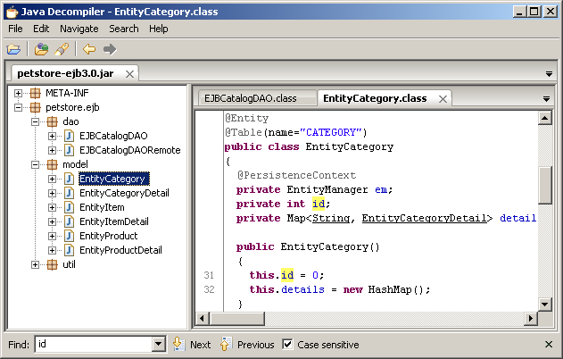
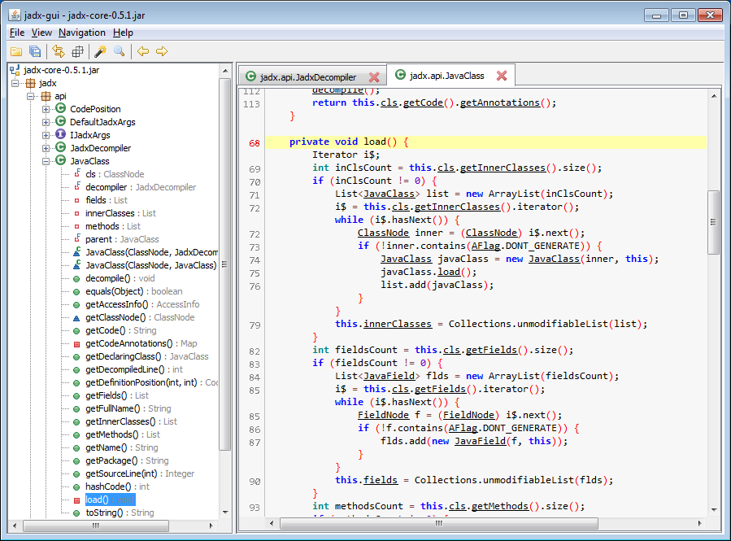
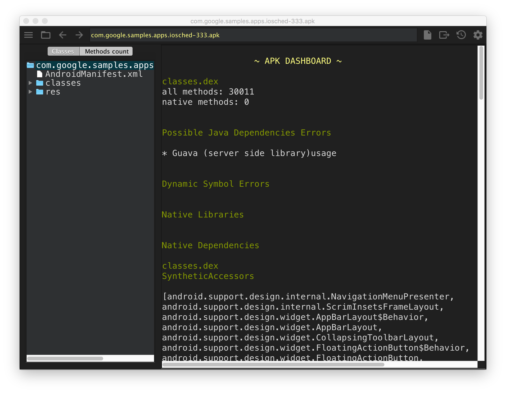
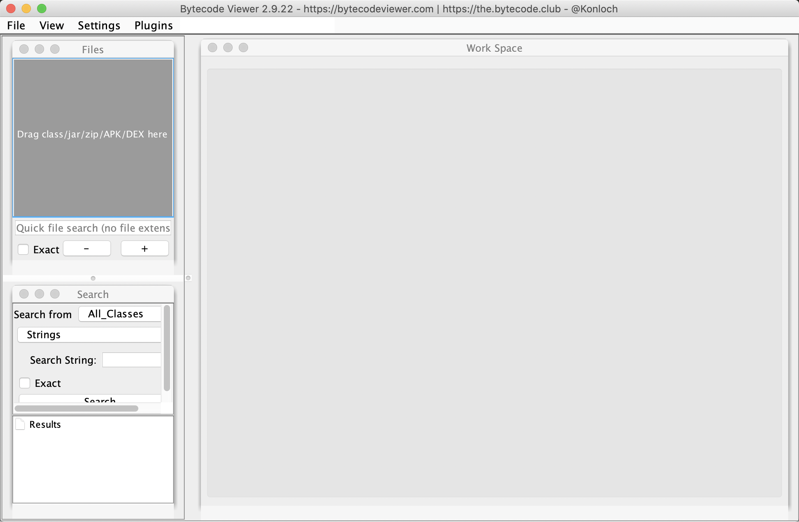

# decompile-apk

[English](README.md) | 简体中文

decompile-apk 由一组脚本和多款反编译工具组成，可以自动反编译 Android APK，得到 Java 源码和资源文件，并在图形界面中查看。

* jd-gui



* jadx



* classyshark



* bytecode-viewer



## 工具
仓库中不再内置工具。各脚本首次运行时，会从工具的官方 GitHub Release 下载所需工具，并校验 SHA-256（见 `setup.sh`）。

* [Apktool](https://github.com/iBotPeaches/Apktool)：v3.0.3
* [dex2jar](https://github.com/ThexXTURBOXx/dex2jar)：v2.4.38（[pxb1988/dex2jar](https://github.com/pxb1988/dex2jar) 的持续维护分支）
* [jd-gui](https://github.com/java-decompiler/jd-gui)：v1.6.6（2019 年后没有新版本）
* [jadx](https://github.com/skylot/jadx)：v1.5.6
* [android-classyshark](https://github.com/google/android-classyshark)：v8.2（Google 已归档，不再维护）
* [bytecode-viewer](https://github.com/Konloch/bytecode-viewer)：v2.13.2

## 环境要求
* Bash、curl、unzip
* JDK 17 及以上（已在 JDK 21 上测试）

## 支持平台
* Mac
* Linux / Unix

## 下载
[decompile-apk](https://github.com/venshine/decompile-apk/releases)

## 用法

```shell
# 可选：提前下载全部工具（否则在首次使用时下载）
bash setup.sh

# 使用集成工具反编译 APK（推荐）
bash decompile-apk.sh *.apk

# 使用 apktool / dex2jar / jd-gui 反编译 APK
bash jdgui-apk.sh *.apk

# 使用 jadx 反编译 APK
bash jadx-apk.sh *.apk

# 使用 classyshark 反编译 APK
bash classyshark-apk.sh *.apk

# 使用 bytecode-viewer 反编译 APK
bash bytecode-viewer.sh *.apk

```

## 对比
* Apktool
	* 优点
		* 资源文件完整
		* 源码详细
	* 缺点
		* 使用较复杂，需要组合多个工具
		* 不便于查看 APK 的整体架构
* classyshark
	* 优点
		* 使用简单，一条命令即可
		* 源码目录结构清晰，可以图形化查看整个 APK 的架构
	* 缺点
		* 源码过于简略
		* 无法获取资源文件
* jadx
	* 优点
		* 方便快捷
		* 图形界面更完善，实用功能更多
		* 反编译代码可读性高
	* 缺点
		* 部分资源文件缺失

* bytecode-viewer
	* 优点
		* 支持 APK、dex、jar 等多种格式
		* 可视化反馈更好
	* 缺点
		* 分析文件较慢

## 待办
* 支持更多反编译工具
* 支持反编译 dex / aar / jar 文件

## 关于
[venshine.cn@gmail.com](venshine.cn@gmail.com)

## 许可证
[Apache 2.0](http://www.apache.org/licenses/LICENSE-2.0.html)
